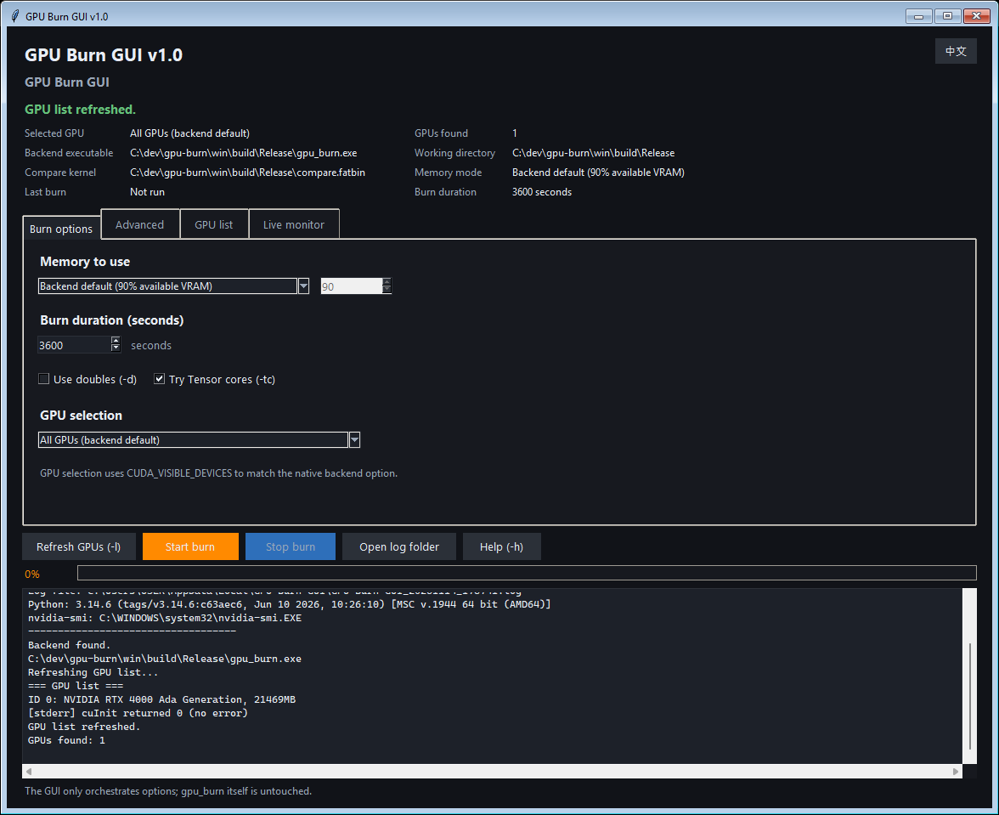
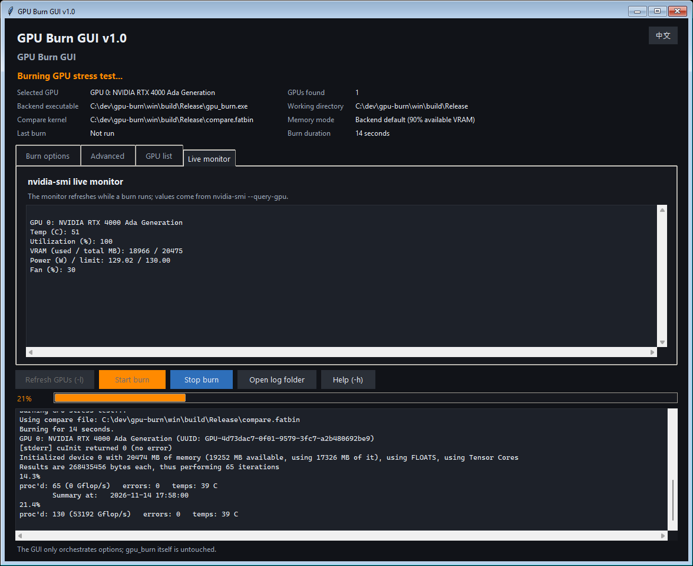
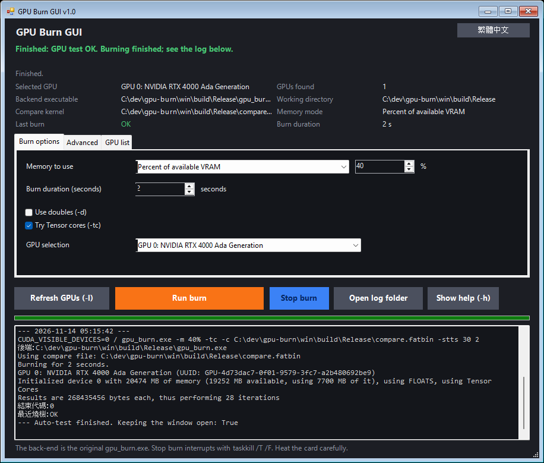

# gpu-burn

Multi-GPU CUDA stress test
<http://wili.cc/blog/gpu-burn.html>

- [gpu-burn](#gpu-burn)
  - [Easy docker build and run](#easy-docker-build-and-run)
  - [Binary packages](#binary-packages)
  - [Building](#building)
  - [Usage](#usage)
  - [Linux GUI front-end](#linux-gui-front-end)
  - [Windows GUI front-end](#windows-gui-front-end)

## Easy docker build and run

```plain
git clone https://github.com/wilicc/gpu-burn
cd gpu-burn
docker build -t gpu-burn .
docker run --rm --gpus all gpu-burn
```
By default the container burns for 60 seconds.  To pass [options](#usage), give the full command:

```plain
docker run --rm --gpus all gpu-burn ./gpu_burn -m 50% 3600
```
You can pass build arguments to specify the CUDA version, the compute capability, and base image distro, e.g.:

```plain
docker build --build-arg CUDA_VERSION=13.0.0 --build-arg COMPUTE=75 --build-arg IMAGE_DISTRO=ubi8 -t gpu-burn .
```
## Binary packages

<https://repology.org/project/gpu-burn/versions>

## Building

To build GPU Burn:

`make`

To remove artifacts built by GPU Burn:

`make clean`

GPU Burn builds with a default Compute Capability of 7.5 as specified on NVIDIA's [CUDA GPU Compute Capability](https://developer.nvidia.com/cuda-gpus).
To override this with a different value:

`make COMPUTE=<compute capability value>`

`COMPUTE` selects a single virtual architecture for the default `-arch`
flag.  For a fat binary targeting multiple architectures, or to opt into
architecture-conditional (`sm_90a`) or family-specific (`compute_100f`)
features, set `COMPUTE=` to suppress the default and drive the build
entirely from `-gencode` flags via `NVCCFLAGS`:

`make COMPUTE= NVCCFLAGS='-gencode=arch=compute_86,code=sm_86 -gencode=arch=compute_90,code=sm_90'`

CFLAGS can be added when invoking make to add to the default
list of compiler flags:

`make CFLAGS=-Wall`

LDFLAGS can be added when invoking make to add to the default
list of linker flags:

`make LDFLAGS=-lmylib`

NVCCFLAGS can be added when invoking make to add to the default
list of nvcc flags:

`make NVCCFLAGS=-ccbin <path to host compiler>`

CUDAPATH can be added to point to a non standard install or
specific version of the cuda toolkit (default is
/usr/local/cuda):

`make CUDAPATH=/usr/local/cuda-<version>`

CCPATH can be specified to point to a specific gcc (default is
/usr/bin):

`make CCPATH=/usr/local/bin`

CUDA_VERSION and IMAGE_DISTRO can be used to override the base
images used when building the Docker `image` target, while IMAGE_NAME
can be set to change the resulting image tag:

`make IMAGE_NAME=myregistry.private.com/gpu-burn CUDA_VERSION=12.0.1 IMAGE_DISTRO=ubuntu22.04 image`

## Usage

```plain
    GPU Burn
    Usage: gpu_burn [OPTIONS] [TIME]
    
    -m X   Use X MB of memory
    -m N%  Use N% of the available GPU memory
    -d     Use doubles
    -tc    Try to use Tensor cores (if available)
    -l     List all GPUs in the system
    -i N   Execute only on GPU N
    -c FILE   Use FILE as compare kernel (default compare.fatbin)
    -stts T   SIGTERM timeout seconds for child processes (default 30)
    -h     Show this help message
    
    Example:
    gpu_burn -d 3600
```

## Linux GUI front-end

The Linux port also has a Tkinter wrapper, [linux/GPU-Burn-GUI.py](linux/GPU-Burn-GUI.py), around the unchanged native `gpu_burn`. It mirrors the Windows GUI's options, live burn console, and `nvidia-smi` monitor while leaving the backend untouched.





Build the native backend first (`make`), then launch from the repository root:

```bash
python3 linux/GPU-Burn-GUI.py
# or
sh linux/GPU-Burn-GUI.sh
```

- memory mode (`-m`): backend default (90% available VRAM), percent, or fixed MB; duration (`TIME`) defaults to **3600 seconds**
- doubles (`-d`) unchecked by default, Tensor cores (`-tc`) checked by default
- GPU selection via `CUDA_VISIBLE_DEVICES`, matching the Windows GUI
- compare kernel (`-c`) and SIGTERM timeout (`-stts`)
- live burn console shows every stdout/stderr line; the progress bar follows the backend's percentage redraws
- live monitor tab refreshes `nvidia-smi` every second: GPU name, temperature, utilization, VRAM used/total, power draw/limit, fan speed
- **Stop burn** sends SIGTERM to the backend process group, then SIGKILL if it does not exit within three seconds; closing the window during a burn stops it too

The GUI uses stdlib Tkinter only (install `python3-tk` if needed), finds the native backend next to the repository or on `PATH`, and writes UTF-8 logs under `$XDG_STATE_HOME/gpu-burn-gui` (fallback `~/.local/state/gpu-burn-gui`). See [linux/README.md](linux/README.md#gpu-burn-gui-linux) for the complete option map, environment overrides, known limitations, and smoke-test steps.

## Windows GUI front-end

The Windows port has a WinForms wrapper, [GPU-Burn-GUI.cmd](GPU-Burn-GUI.cmd), around the original `gpu_burn.exe`:



It exposes the same options in one window:

- memory mode: backend default, percent, or fixed MB (`-m`), with a duration (`TIME`)
- doubles (`-d`), Tensor cores (`-tc`)
- GPU selection (via `CUDA_VISIBLE_DEVICES`, because the packaged `-i` path fails)
- compare kernel (`-c`) and SIGTERM timeout (`-stts`)
- Refresh GPUs (`-l`), help (`-h`), and a Stop burn button (`taskkill /T /F`)
- Live burn console shows every `gpu_burn.exe` stdout line, including progress
  redraws, in the bottom log
- Live monitor tab refreshes `nvidia-smi` every second: GPU name, temperature,
  utilization, VRAM used/total, power draw/limit, and fan speed; it is selected
  automatically when a burn starts
- The window opens with Tensor cores (`-tc`) enabled and the burn duration set
  to 3600 seconds; change either before running if desired

It keeps the backend untouched and finds `gpu_burn.exe`/`compare.fatbin` next to itself or in the usual build/package folders. See [win/README.md](win/README.md#gui-front-end) for caveats and the smoke-test walkthrough.
