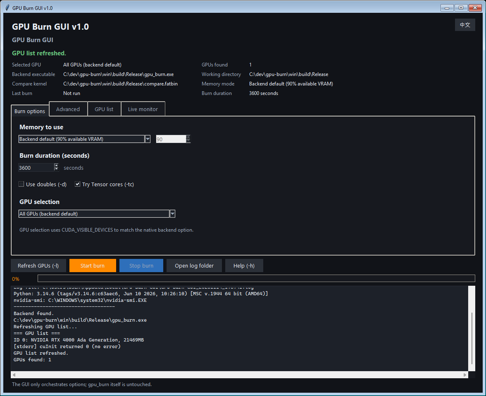
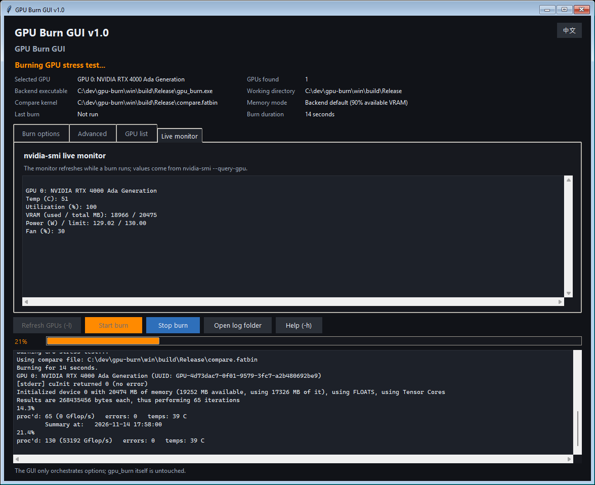

# GPU Burn GUI (Linux)

The Linux GUI is a Tkinter front-end for the unchanged `gpu_burn` backend.
It mirrors the Windows GUI's options, live burn console, and `nvidia-smi`
monitor without changing the backend or its CLI.

## Screenshots





## Requirements

- Python 3.10+ with Tkinter (`python3-tk` on Debian/Ubuntu,
  `python3-tkinter` on Fedora, `tk` on Arch)
- An NVIDIA GPU and driver with `nvidia-smi` on `PATH`
- The native backend built from the repository root with `make`, producing
  `gpu_burn` and `compare.fatbin`; the GUI will not modify either file
- The CUDA toolkit used by `make` to build `compare.fatbin`

If `nvidia-smi` is missing the GUI still burns GPUs, but the live monitor tab
shows that it could not be found.

## Build and launch

```bash
cd gpu-burn       # repository root, not linux/
make COMPUTE=89   # example for Ada; use your GPU's compute capability
python3 linux/GPU-Burn-GUI.py
```

or, from the repository root:

```bash
sh linux/GPU-Burn-GUI.sh
```

The launcher is a thin `exec python3` wrapper; the Python script can also be
run directly from any directory. The GUI discovers:

1. `GPU_BURN_GUI_BACKEND` if set;
2. `gpu_burn` next to the repository root, in `linux/`, in the current
   directory, or in `build/`;
3. `gpu_burn` on `PATH`.

`compare.fatbin` is looked up next to the backend first, then in the
repository root, then in the current directory.

## Options and defaults

The **Burn options** tab covers the native CLI:

| GUI control | Backend option | Notes |
| --- | --- | --- |
| Memory mode | `-m` | backend default (90% available VRAM), percent of available VRAM, or fixed MB |
| Burn duration | `TIME` | spin box; default **3600 seconds** |
| Use doubles | `-d` | unchecked by default |
| Try Tensor cores | `-tc` | **checked by default** |
| GPU selection | `CUDA_VISIBLE_DEVICES` | all GPUs or one listed GPU; mirrors the Windows GUI because the packaged `-i` path has known problems |

The **Advanced** tab covers:

- Compare kernel (`-c`) with a file browser and a text field for the path
- SIGTERM timeout seconds (`-stts`) with a spin box

The action row has **Refresh GPUs (-l)**, **Start burn**, **Stop burn**,
**Open log folder**, and **Help (-h)**.

The backend's defaults map to:

- memory: backend default, i.e. up to 90% of available VRAM
- duration: 3600 seconds
- doubles: off
- Tensor cores: on
- all GPUs visible through `CUDA_VISIBLE_DEVICES`

`-tc` and duration **3600** are the same starting values as the Windows GUI.
Change them before pressing **Start burn**. Setting memory mode to a fixed MB
or a percentage enables the value spin box; backend default leaves it disabled.

## Live burn output and monitor

When **Start burn** starts:

- the live console shows every `gpu_burn` stdout/stderr line, including the
  carriage-return progress redraws;
- percentage lines drive the progress bar;
- the **nvidia-smi 即時監控** tab is selected automatically and refreshes every
  second with GPU name, temperature, utilization, VRAM used/total, power
  draw/limit, and fan speed;
- **Stop burn** sends SIGTERM to the backend's process group and escalates to
  SIGKILL after three seconds; closing the window while a burn runs also stops
  the backend group.

The GUI uses `os.setsid()`/`os.killpg()` on Linux so stopping reaches child
processes of `gpu_burn`. On Windows, the same script falls back to
`CREATE_NEW_PROCESS_GROUP` and `taskkill /T /F` for the compatibility test.

## Logs

The GUI logs startup information, the GPU list, burn output, and results to:

```
$XDG_STATE_HOME/gpu-burn-gui/GPU-Burn-GUI_<timestamp>.log
```

or `~/.local/state/gpu-burn-gui/` when `XDG_STATE_HOME` is not set. Logs are
UTF-8. **Open log folder** opens that directory with the file manager.

## Environment variables

Useful overrides when the GUI cannot discover a file:

- `GPU_BURN_GUI_BACKEND` — native `gpu_burn` path
- `GPU_BURN_GUI_COMPARE` — `compare.fatbin` path
- `GPU_BURN_GUI_NVIDIA_SMI` — `nvidia-smi` path
- `GPU_BURN_GUI_LANG` — `en` or `zh-TW`

Test-only variables (used during development; harmless in normal use):

- `GPU_BURN_GUI_TEST=1` — refresh GPUs and auto-select the first GPU
- `GPU_BURN_TEST_SECONDS=N` — start a burn of N seconds automatically
- `GPU_BURN_GUI_TEST_KEEP=1` — keep the window open after the auto-test;
  combine it with `GPU_BURN_GUI_TEST=1` to inspect the finished state

## Verification evidence

The screenshots were captured on the development machine through its Windows
fallback (Windows backend and NVIDIA RTX 4000 Ada GPU) because this host does
not have a native Linux GPU session. The same Tkinter Python script was
exercised; Linux-specific discovery and process-group paths are selected by
`os.name` at runtime. A native Linux check requires a Linux host with an NVIDIA
GPU and the CUDA toolkit. Logs from the smoke run are under
`%LOCALAPPDATA%\GPU-Burn-GUI` on Windows.

Suggested native Linux smoke test:

```bash
GPU_BURN_GUI_TEST=1 GPU_BURN_TEST_SECONDS=12 \
  python3 linux/GPU-Burn-GUI.py
```

Expected GUI result: `Tested 1 GPUs: GPU 0: OK`, a green **完成：GPU 測試結果良好** status, and the nvidia-smi panel showing live telemetry.

## Notes

- The GUI starts only when the native backend exists; run `make` first.
- GPU selection uses `CUDA_VISIBLE_DEVICES`, matching the Windows GUI. The
  native `gpu_burn -i N` option is also available from the CLI; the GUI avoids
  it because the packaged Windows backend's `-i` path is unreliable.
- The backend receives `-tc`, `-c`, and duration options assembled only from
  the selections; no source file is edited.
- The window uses a dark WinForms-inspired Tk theme; Linux window chrome and
  window-manager title bars follow the desktop theme.
- The live monitor needs `nvidia-smi` to report fields supported by the query
  (`temperature.gpu`, `utilization.gpu`, `memory.used`, `memory.total`,
  `power.draw`, `power.limit`, `fan.speed`); some older cards may not report
  every field, in which case the GUI reports the read error instead of
  overwriting the console.
