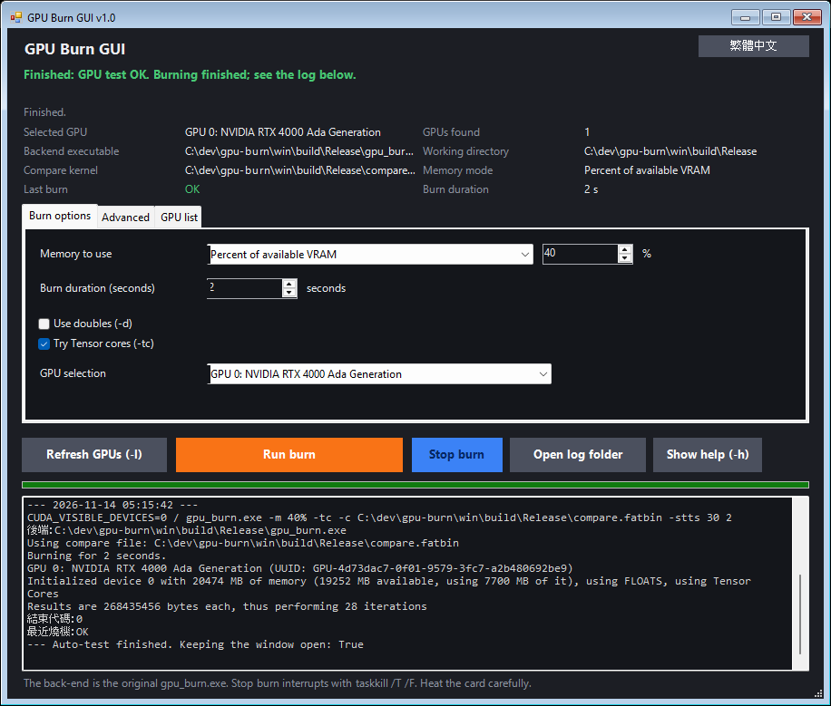

# gpu-burn (Windows)

Windows port of [gpu-burn](https://github.com/wilicc/gpu-burn).
Same stress-test behaviour as the Linux version; differences are limited
to the host process model (Windows threads + named pipes instead of
`fork(2)` + Unix pipes) and the build system.

## Requirements

- Windows 10/11
- CUDA Toolkit 11.0+ (13.0+ for `compute_120` / Blackwell)
- CMake 3.18+
- Visual Studio 2019 or 2022 with the C++ build tools
- An NVIDIA driver with `nvidia-smi` on `PATH`

## Building

```batch
build.bat                  REM defaults to compute_75 (Turing)
build.bat -c 86            REM Ampere
build.bat -c 89            REM Ada
build.bat -c 90            REM Hopper
build.bat -c 120           REM Blackwell
build.bat -c 86 -d         REM Debug build
```

The `compare.cu` kernel is shared with the Linux build and lives at the
repository root. `build.bat` is a thin wrapper around CMake; equivalent
manual invocation:

```batch
cmake -S . -B build -DCOMPUTE=120
cmake --build build --config Release
```

The resulting `gpu_burn.exe` and `compare.fatbin` are placed in
`build\Release\` (or `build\Debug\`).

## Usage

Same flags as the Linux binary. See the root [README](../README.md) and
`gpu_burn.exe -h`.

```batch
gpu_burn.exe -d 3600       REM burn all GPUs with doubles for an hour
gpu_burn.exe -m 50% 60     REM 50% of available VRAM, 1 minute
gpu_burn.exe -i 0 60       REM only GPU 0
gpu_burn.exe -l            REM list GPUs and exit
```

## GUI front-end

`GPU-Burn-GUI.cmd` (repository root) is a WinForms front-end around the
unchanged `gpu_burn.exe`. It discovers the backend next to itself or in
the build/package folders.



The GUI mirrors the command-line options:

- Memory mode: backend default, percent of available VRAM, or fixed MB (`-m`)
- Burn duration (`TIME`), doubles (`-d`), Tensor cores (`-tc`)
- GPU selection through `CUDA_VISIBLE_DEVICES` (the packaged backend's `-i`
  path fails because it does not initialize CUDA; the GUI uses the
  environment variable instead)
- Compare kernel (`-c`) and SIGTERM timeout (`-stts`)
- Refresh GPUs (`-l`) and help (`-h`)

The burn runs hidden; stdout/stderr are captured into log files, every stdout
line (including the CR progress redraws) is appended to the live log, and the
GUI turns progress into a progress bar. During a burn the GUI selects the
`Live monitor` tab and refreshes `nvidia-smi` every second for GPU name,
temperature, utilization, VRAM used/total, power draw/limit, and fan speed.
A Stop burn button terminates the process tree with `taskkill /T /F`. The
smoke-test path used during development can be enabled with
`GPU_BURN_GUI_TEST=1`; `GPU_BURN_GUI_TEST_KEEP=1` keeps the window open for
inspection. The GUI starts with Tensor cores (`-tc`) checked and burn duration
3600 seconds; change the options before starting a burn.

Known packaged-backend quirks:

- `gpu_burn.exe -i 0 ...` fails with an initialization error, so this GUI
  selects GPUs with `CUDA_VISIBLE_DEVICES` instead.
- `gpu_burn.exe -d ...` may hang after the test on this build; use **Stop burn**
  if needed.

Smoke evidence: [gui-smoke-en.png](../docs/screenshots/gui-smoke-en.png),
[gui-smoke-zh.png](../docs/screenshots/gui-smoke-zh.png),
[gui-live-monitor-zh.png](../docs/screenshots/gui-live-monitor-zh.png),
[gui-defaults-zh.png](../docs/screenshots/gui-defaults-zh.png), and the logs
under `%LOCALAPPDATA%\GPU-Burn-GUI`.
